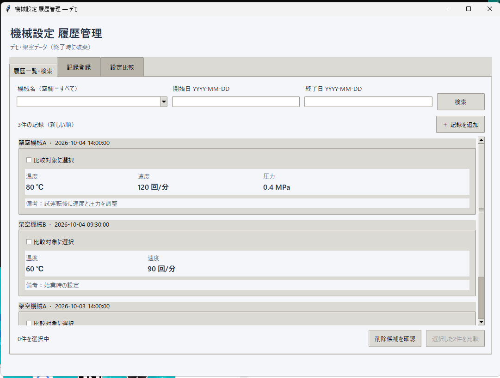
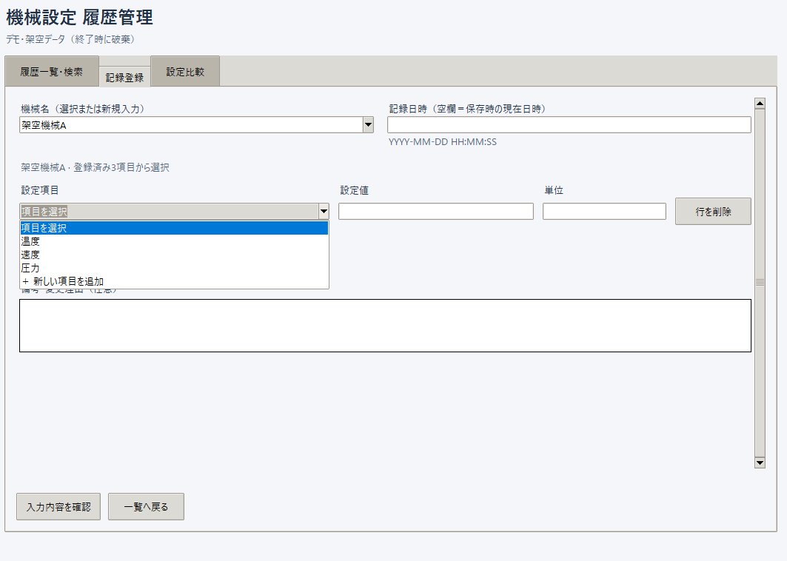
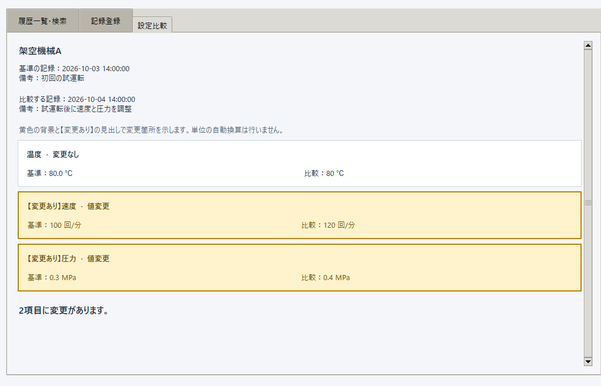

# Machine Settings History

## GUI版（2026年10月7日更新）

製造現場の設定記録を題材にした個人開発アプリです。履歴を探す操作と、同じ設定項目名を毎回入力する手間を減らすことを目的としています。本人によるCLI版・GUI版の操作時間比較を実施しました。現場導入と第三者による使いやすさの評価は未実施です。

既存のPython標準ライブラリ・CSVによる処理に、TkinterのPC用画面を追加しました。最初は `START_HERE.md` を参照してください。

```powershell
py gui.py --demo
```

`start-demo.bat`でも起動できます。デモは `examples/records.csv` の架空データを一時フォルダーへコピーし、終了時に破棄します。通常起動は `py gui.py` または `start-app.bat` です。保存先を変える場合は `py gui.py --data-dir practice-data` を使います。

### 開発の背景と改善内容

既存のCLI版では、目的の設定値を見るまでの操作が多く、コマンド入力や操作手順の習得が必要でした。CLIの知識がなくても画面から操作でき、少ない操作で設定値を確認できることを目標にGUIを追加しました。

| 課題 | 対応 |
|---|---|
| 設定値を確認するまでの操作が多い | 履歴一覧に項目名・値・単位を直接表示 |
| CLIの操作方法の習得が必要 | ボタン・選択欄で記録、検索、比較を操作 |
| 項目名を繰り返し入力する手間 | 機械ごとに既存項目を選択し、新規項目だけ名前・単位を登録 |

### 操作時間の比較（本人による測定）

計測範囲は**アプリの起動から目的の設定値を確認するまで**です。各版を本人が3回ずつ操作しました。

| 回 | CLI版 | GUI版 |
|---|---:|---:|
| 1回目 | 50秒 | 15秒 |
| 2回目 | 40秒 | 13秒 |
| 3回目 | 35秒 | 12秒 |
| 平均 | 41.7秒 | 13.3秒 |

未丸めの平均から算出すると、平均28.3秒、**68％の短縮**となりました。短縮率は `(125 - 40) / 125 × 100 = 68％` です。起動を含む一連の作業時間であり、検索処理そのものの速度を測った結果ではありません。

これは本人1名・各3回の測定結果です。操作への慣れの影響を含み、他の利用者や実際の現場で同じ効果が得られることを保証するものではありません。対象記録・データ件数・計測順序の詳細は未記録です。CLI未経験者による操作評価は今後の課題です。

### 画面紹介

以下は本人のPCで撮影した架空データのデモ画面です。

**履歴一覧：** 詳細画面を開かず、設定値と備考を確認できます。



**記録入力：** 登録済みの温度・速度・圧力を選択でき、「新しい項目を追加」から項目を増やせます。



**設定比較：** 同じ機械の2記録を比較し、値や単位、項目の有無の違いを表示します。



変更項目は黄色の背景・太字の「【変更あり】」で強調します。本人のWindows環境で表示を確認し、2026年10月7日に提供された修正後の画面画像を掲載しています。

### 開発での役割とAIの利用

本人が課題を提示し、一覧での直接表示や設定項目の選択などの要件を決め、画面の操作確認と時間測定を行いました。GUI追加・比較・項目定義の保存処理やテストの実装にはCodexを利用しました。応募時には、本人が判断した内容とAIが支援した実装を区別して説明します。

### 画面の操作

- 履歴一覧で、設定項目・値・単位・備考を直接確認できます。
- 登録画面では、機械ごとの設定項目をプルダウンから選択します。単位は定義から取得します。
- 同じ選択欄の「新しい項目を追加」を選んだ場合だけ、名前と単位を入力します。記録保存後、次回の選択肢に加わります。
- 設定値は空欄から入力します。選んだ項目を変えた場合も数値をクリアします。
- 「入力する項目を増やす」で行を追加し、不要な行は削除できます。行の削除で項目定義や過去の記録は消えません。
- 機械を切り替えて戻ると、終了前であれば入力途中の下書きを復元します。
- 登録前に内容確認を行います。戻って修正できます。
- 同じ機械の2記録を選択すると、数値の変更、項目の追加・欠落、単位変更を確認できます。
- 削除候補を表示し、確認チェックを付けてから削除します。確認なしの自動削除は行いません。

### 保存と制限

記録は既存形式の `data/records.csv`、機械ごとの項目定義は `data/settings.csv` に保存します。旧版の履歴はそのまま読み込めます。登録されていない項目定義は既存履歴から補完します。

記録の保存後に項目定義の保存だけ失敗した場合は「記録は保存済み」と表示します。同じ記録を再登録せず、保存先を確認してください。次の読み込み時に履歴から選択肢を補完します。削除前に項目定義を保存するため、履歴が消えても項目の選択肢は残ります。

単一プロセスでのローカル利用が対象です。アプリの多重起動、CLIとの同時利用、実行中のCSV外部編集、iPadからの利用は対象外です。項目の名称・単位を編集する管理画面、ログイン・権限、自動バックアップはありません。

TkinterはWindows用Pythonの一般的な配布に含まれますが、インストール内容によって利用できない場合があります。`py -m tkinter` で確認できます。公式資料： https://docs.python.org/3/library/tkinter.html

設計の理由と失敗時の処理は `DESIGN.md`、確認結果は `VERIFICATION.md` を参照してください。

### テスト

```powershell
py -m unittest -v
```

`test_gui.py` は実際のTk画面を使用するため、表示環境がない場合はスキップされます。テストでは一時フォルダーと架空データのみを使用します。

## 旧CLIの操作・既存仕様

機械設定値を記録し、過去の履歴を検索するPythonコマンドラインツールです。
Python標準ライブラリだけを使用します。Python 3.14.3で動作確認しています。

## 起動・テスト (PowerShell)

Pythonをインストールしたうえで、プロジェクトのディレクトリで初回のみ仮想環境を作成します。

```powershell
py -m venv .venv
```

作成後は、以下のコマンドで起動・テストできます。

プロジェクトのディレクトリで実行します。既存の仮想環境を直接指定できます。

```powershell
.\.venv\Scripts\python.exe main.py
.\.venv\Scripts\python.exe -m unittest -v
```

仮想環境を有効化して使う場合:

```powershell
.\.venv\Scripts\Activate.ps1
python main.py
python -m unittest -v
```

追加パッケージのインストールは不要です。テストは一時ディレクトリと架空データを使い、実際の保存先を変更しません。

## 操作

- `1: 記録`: 機械名・記録日時を1回入力し、設定項目名・数値・単位を繰り返し入力します。設定項目名を空欄にすると設定項目の入力完了です。その後、今回の記録に共通する任意の備考を1回だけ入力します。すべて正常な場合だけ1回分をまとめて保存します。
- `2: 履歴一覧`: 全記録を日時の新しい順に、設定項目を記録単位にまとめて表示します。機械別の全履歴件数も表示します。
- `3: 検索`: 機械名 (完全一致)・開始日・終了日で検索します。各条件の空欄は制限なしです。
- `4: 削除候補・確認`: 機械別の全履歴を対象に、91件目以降の機械名・ID・日時・設定項目数を表示します。`yes`と入力した場合だけ、表示した候補を一括削除します。
- `0: 終了`: ツールを終了します。

記録入力中の入力エラーは、該当項目を再入力します。検索条件の日付が不正な場合は、エラーを表示してメニューへ戻るため、「3: 検索」を選び直してください。記録入力中のCtrl+Cや入力終了 (EOF) では保存せず終了します。削除確認の空欄や`yes`以外の入力はキャンセルで、CSVを変更しません。

## 入力形式

- 機械名・設定項目名は必須です。前後の空白を除きます。
- 設定項目は1つ以上必要です。同じ入力内で同じ設定項目名は使えません。
- 設定値は有限の数値です。整数、小数、符号、指数表記 (例: `-12`、`0.25`、`1e3`) を許可します。`ON`、空欄、`NaN`、無限大、桁区切りカンマは拒否します。Decimalで検証し、入力表現を文字列で保存します。
- 単位と備考は任意です。備考は設定項目の入力完了後に1回だけ入力し、今回作成する全設定行の`note`に同じ内容を保存します。備考入力中に中断した場合も保存しません。
- 通常の記録は、記録日時を入力せずEnterで進めてください。入力完了時にPCのローカルの現在日時を1回取得し、全設定行で共有します。過去の記録を登録する場合は、`YYYY-MM-DD HH:MM:SS` (例: `2026-09-09 12:30:00`) で日時を入力してください。
- 検索日付は`YYYY-MM-DD`です。開始日・終了日を両方含みます。開始日が終了日より後ならエラーです。

## 保存仕様

保存先は`main.py`と同じディレクトリの`data/records.csv`です。起動時の作業ディレクトリには依存しません。未作成なら空の履歴として扱い、初回保存で作成します。

UTF-8のCSVで、列順は次のとおりです。UTF-8 BOM付きCSVの読み込みにも対応します。

```text
record_id,recorded_at,machine_name,setting_name,value,unit,note
```

入力1回につき`uuid.uuid4()`でIDを生成し、既存の全IDとの衝突時には再生成します。同じ入力の全設定行が同じIDを持ち、設定項目ごとに1行を保存します。件数は行数ではなく、機械ごとの異なるID数です。

既存行の順序を維持して末尾に追加します。同日時ではCSV内で最初の行が後に現れる記録を優先するため、後から保存した記録が上位になります。削除でも残す行の順序を変えません。

追加・削除とも保存後の全行を同じディレクトリの一時ファイルへ書き、`flush`、`fsync`、クローズの後に`os.replace`で置き換えます。置き換え前の失敗では既存CSVを維持します。失敗は画面に表示し、成功した場合だけ保存・削除完了を表示します。

ヘッダー不正、行の列数不正、不正な数値・日時、同一ID内の機械名・日時の不一致、同名設定項目などを検出した場合は処理を停止します。読み込めないCSVを空データとして上書きしません。0バイトの既存CSVも不正として扱います (ヘッダーのみのCSVは正常な0件の履歴です)。

## 90件判定・削除仕様

検索条件と無関係に、機械ごとの全履歴から最新90件を保持対象とし、91件目以降だけを候補にします。過去日時を指定して新規登録した場合、その記録が候補になることもあります。

自動削除はしません。確認しない限り90件を超えて保存されます。承認した場合、表示した候補IDに属する全行だけを削除し、それ以外は維持します。

## 制限・ファイル構成

初版は同時に1プロセスで利用してください。実行中に他のソフトでCSVを編集しないでください。排他制御、バックアップ・復元、ディスク故障への保護はありません。タイムゾーン情報は保存しません。

CSVを外部で並べ替えると同日時の順位も変わります。同じID・機械名・日時で異なる項目を持つ別入力が外部で混在した場合、現在の列構成だけでは識別できません。一時ファイルの削除にも失敗した場合は`.records-*.tmp`が残る場合があります。

- `main.py`: メニュー、入力、表示、削除確認、処理の呼び出し
- `storage.py`: CSVの読み込み、安全な保存
- `history.py`: 入力検証、記録作成、検索、グループ化、機械別件数、90件判定、削除対象の除外
- `test_storage.py`: CSVと保存失敗のテスト
- `test_history.py`: 履歴処理とメニューの保存・削除確認のテスト

会社の実データは開発・テストに使用しないでください。`data/records.csv`はGit管理対象外です。
